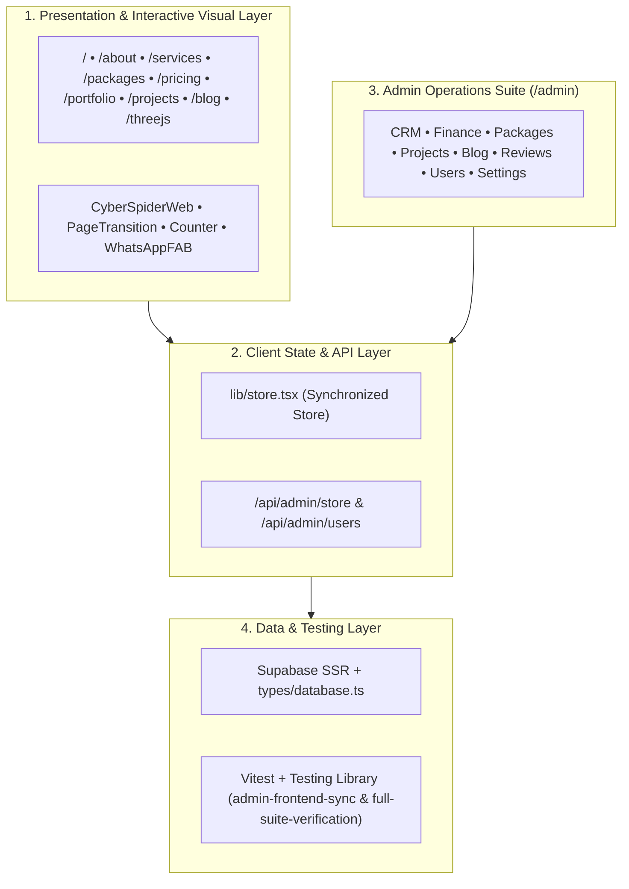

# Black Spider (`spider-marketingagencyplateform`) — Marketing Agency Platform & Admin Suite

A full-stack Next.js 16 (`16.4.5`), React 19, Framer Motion, and Supabase web platform for a digital marketing agency, pairing high-impact interactive visuals (`CyberSpiderWeb`, `/threejs`, `WhatsAppFAB`) with a complete backend CRM, finance, package management, and user administration suite.

---

## 1. Executive Summary & Purpose
`spider-marketingagencyplateform` (`black-spider` / `spider/`) is an agency growth engine designed to both **impress prospective clients** and **run internal agency operations**. Visitors explore services, packages, pricing, portfolio case studies, and interactive 3D/cybernetic showcases before converting via contact forms or the floating WhatsApp CTA. Internally, agency staff manage leads, client projects, packages, reviews, blog articles, and finances in `/admin`.

---

## 2. System Architecture & Layers



| Layer | Responsibility | Key Files |
| :--- | :--- | :--- |
| **Brand & Interactive Layer** | Custom cybernetic spiderweb canvas, page transitions, counters, and WhatsApp lead capture | `spider/components/{CyberSpiderWeb,PageTransition,Counter,WhatsAppFAB,Navbar,Footer}.tsx`, `spider/app/threejs/page.tsx` |
| **Public Marketing Layer** | Agency positioning, transparent service packages, portfolio, blog, and legal compliance pages | `spider/app/{about,services,packages,pricing,portfolio,projects,blog,contact,privacy,security,terms}/page.tsx` |
| **Admin Operations Layer** | Unified agency back-office with dedicated sidebar/header shell | `spider/app/admin/{crm,finance,packages,projects,blog,reviews,users,settings}/page.tsx`, `spider/app/dashboard/page.tsx` |
| **State & API Layer** | Client/admin synchronized store and protected server endpoints | `spider/lib/store.tsx`, `spider/app/api/admin/{store,users}/route.ts` |
| **Persistence & QA Layer** | Typed Supabase integration, Tailwind v4 design tokens (`tailwind_theme_*.json`), and Vitest integration tests | `spider/lib/supabase.ts`, `spider/types/database.ts`, `spider/__tests__/*.test.tsx` |

---

## 3. Core Functionality & Modules
- **High-Conversion Public Site**:
  - Service showcases (`/services`, `/packages`, `/pricing`), case studies (`/portfolio`, `/projects`), thought leadership (`/blog`), interactive `/threejs` showcase, and trust/compliance pages (`/privacy`, `/security`, `/terms`).
- **Admin Operations (`/admin`)**:
  - **CRM (`/admin/crm`)** & **Projects (`/admin/projects`)**: Track leads, client pipelines, and active campaigns.
  - **Finance (`/admin/finance`)** & **Packages (`/admin/packages`)**: Manage agency retainers, revenue, and service tiers.
  - **CMS (`/admin/blog`, `/admin/reviews`)**: Publish blog content and verified client testimonials synchronized directly with the public frontend (`admin-frontend-sync.test.tsx`).
  - **Access Control (`/admin/users`, `/admin/settings`, `/admin/login`)**: Manage staff accounts and platform configuration.

---

## 4. Project Structure
```text
├── spider/
│   ├── __tests__/          # Vitest frontend-admin sync & full suite tests
│   ├── app/
│   │   ├── admin/          # CRM, finance, packages, projects, blog, reviews, users, settings
│   │   ├── api/admin/      # store & users route handlers
│   │   ├── dashboard/      # Agency dashboard
│   │   └── (public pages)  # about, services, packages, pricing, portfolio, projects, threejs, blog, contact
│   ├── components/         # CyberSpiderWeb, WhatsAppFAB, AdminSidebar, AdminHeader, etc.
│   ├── lib/                # store.tsx & supabase.ts
│   └── types/database.ts   # Typed Supabase database schema
├── stitch_source/          # Stitch UI design exports
├── screens_list.json       # Screen inventory
├── tailwind_theme_*.json   # Extracted design system tokens
└── package.json            # Root workspace scripts
```

---

## 5. Getting Started

```bash
git clone https://github.com/islamsamyy/spider-marketingagencyplateform.git
cd spider-marketingagencyplateform
npm --prefix spider install
```

| Script | Description |
| :--- | :--- |
| `npm run dev` | Start dev server (`next dev --webpack -p 3002`) |
| `npm run build` | Production build |
| `npm run lint` | Run ESLint |
| `npm test` | Run Vitest suite (`vitest run`) |

---

## 6. Business Value & Growth Opportunities
- **Unified Agency Operating System**: Combines marketing site, live package pricing, CRM, and finance in one codebase—eliminating subscription sprawl across Webflow, Notion, and standalone CRMs.
- **Client Self-Service Portal**: Expand `/dashboard` into a client-facing campaign reporting portal showing live ad ROAS, deliverables, and invoice history.
- **Retainer Checkout & Automated Onboarding**: Integrate Stripe/Moyasar on `/packages` so clients can subscribe to monthly marketing retainers and automatically provision a project in `/admin/projects`.
- **Productized Agency Boilerplate**: Resell the architecture (Stitch design tokens + synchronized Admin/Frontend store) to other creative and performance marketing agencies.
