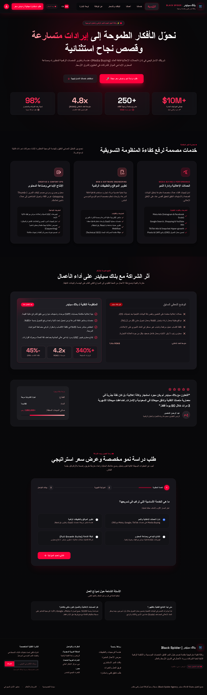
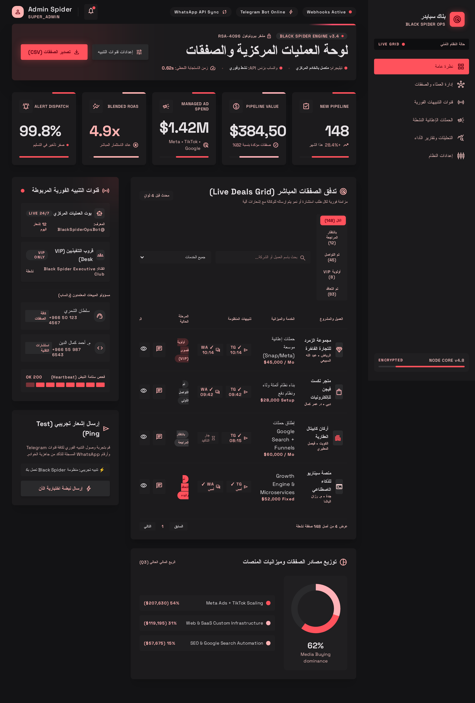
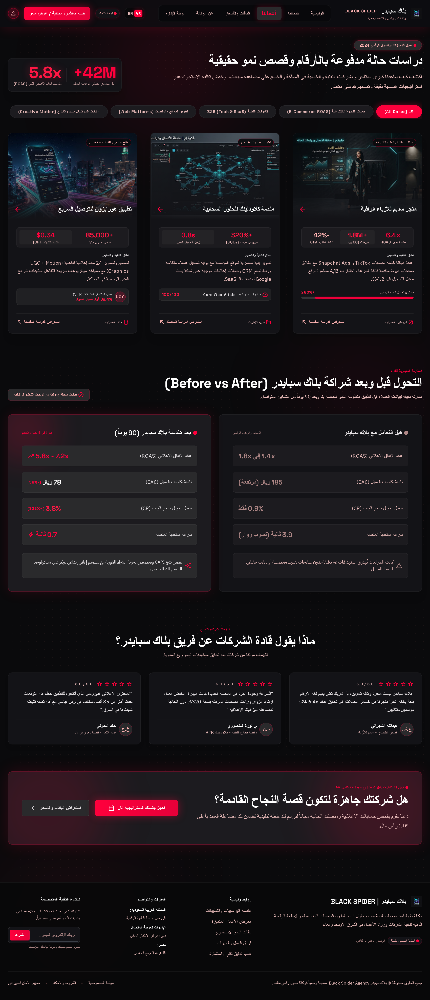
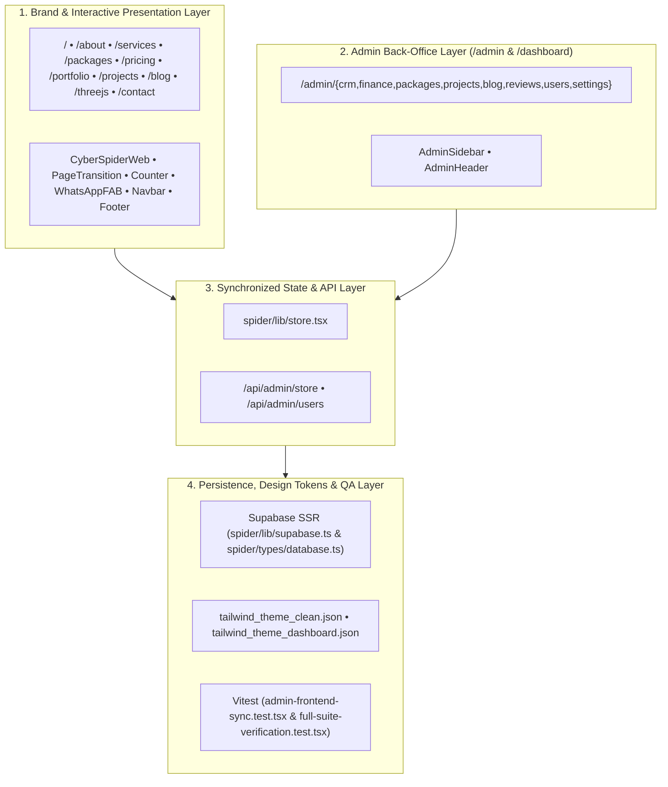

# Black Spider (`spider-marketingagencyplateform`) — Marketing Agency Platform & Operations Suite

<p align="center">
  
</p>

## Table of Contents
- [Executive Summary & Business Utility](#executive-summary--business-utility)
- [Visual Showcase (UI & Dashboards)](#visual-showcase-ui--dashboards)
- [System Architecture & Layers](#system-architecture--layers)
- [Data Model & Synchronized Store](#data-model--synchronized-store)
- [Application Modules & API Endpoints](#application-modules--api-endpoints)
- [Getting Started & Scripts](#getting-started--scripts)
- [Business Value, ROI & Growth Opportunities](#business-value-roi--growth-opportunities)

---

## Executive Summary & Business Utility
`spider-marketingagencyplateform` (`black-spider` / `spider/`) is a full-stack Next.js 16 (`16.4.5`), React 19, Framer Motion, and Supabase platform engineered for a full-service digital marketing agency. It pairs an interactive, high-converting public showcase (`CyberSpiderWeb`, `/threejs`, `WhatsAppFAB`, service packages, portfolio) with a synchronized `/admin` back-office for CRM, finance, projects, packages, blog publishing, client reviews, and user governance.

---

## Visual Showcase (UI & Dashboards)
Design screens captured from Stitch (`stitch_source/` and `screens_list.json`):

| Home & Services Showcase | Integrated Admin Dashboard | Agency Operations View |
| :---: | :---: | :---: |
|  |  |  |

| Packages & Pricing | Portfolio & Case Studies | Settings & CRM View |
| :---: | :---: | :---: |
|  |  |  |

---

## System Architecture & Layers



| Layer | Responsibility | Key Files |
| :--- | :--- | :--- |
| **Interactive Brand Layer** | Custom cybernetic spiderweb background, animated counters, page transitions, and WhatsApp lead widget | `spider/components/{CyberSpiderWeb,PageTransition,Counter,WhatsAppFAB,Navbar,Footer}.tsx` |
| **Public Marketing Funnel** | Agency positioning, tiered packages, transparent pricing, portfolio, 3D demo, and legal pages | `spider/app/{about,services,packages,pricing,portfolio,projects,blog,threejs,contact,privacy,security,terms}/page.tsx` |
| **Admin Operations Layer** | Internal CRM, financial tracking, package editor, project tracker, CMS, and RBAC users | `spider/app/admin/{crm,finance,packages,projects,blog,reviews,users,settings}/page.tsx` |
| **Synchronized Store & API** | Real-time admin-to-frontend content sync and user management endpoints | `spider/lib/store.tsx`, `spider/app/api/admin/{store,users}/route.ts` |
| **Design System & QA Layer** | Extracted Stitch Tailwind v4 tokens and automated Vitest sync tests | `tailwind_theme_*.json`, `spider/__tests__/{admin-frontend-sync,full-suite-verification}.test.tsx` |

---

## Data Model & Synchronized Store
Typed in `spider/types/database.ts` and synchronized via `spider/lib/store.tsx` + `/api/admin/store`:
- **Commercial Entities**: Marketing Packages, Pricing Tiers, Client Projects, Portfolio Items, Financial Records.
- **Growth & CRM Entities**: CRM Leads, Client Reviews, Blog Articles, Admin Users, Site Settings.

---

## Application Modules & API Endpoints

### Public & Client Routes
- `/`, `/about`, `/services`, `/packages`, `/pricing`, `/portfolio`, `/projects`, `/blog`, `/threejs`, `/contact`, `/dashboard`, `/privacy`, `/security`, `/terms`

### Admin Suite (`/admin`)
- `/admin/login`, `/admin`, `/admin/crm`, `/admin/finance`, `/admin/packages`, `/admin/projects`, `/admin/blog`, `/admin/reviews`, `/admin/users`, `/admin/settings`

### API Endpoints
| Route | Purpose |
| :--- | :--- |
| `/api/admin/store` | Persists and synchronizes CMS, packages, projects, reviews, and CRM store state |
| `/api/admin/users` | Admin staff account provisioning and role management |

---

## Getting Started & Scripts

```bash
git clone https://github.com/islamsamyy/spider-marketingagencyplateform.git
cd spider-marketingagencyplateform
npm --prefix spider install
```

| Script | Command | Description |
| :--- | :--- | :--- |
| Dev | `npm run dev` | Start Next.js 16 dev server on port 3002 (`--webpack`) |
| Build | `npm run build` | Production build |
| Lint | `npm run lint` | Run ESLint 9 |
| Test | `npm test` | Run Vitest (`admin-frontend-sync` & `full-suite-verification`) |

---

## Business Value, ROI & Growth Opportunities
- **Zero-Sprawl Agency Operating System**: Replaces separate subscriptions for Webflow, HubSpot, and spreadsheets by unifying lead capture, package pricing, CRM, and finance in one repo.
- **Self-Serve Retainer Checkout**: Integrate Stripe/Moyasar on `/packages` so clients can purchase monthly marketing retainers online and auto-create a workspace in `/admin/projects`.
- **Client Reporting Portal**: Upgrade `/dashboard` to pull live Meta/Google Ads ROAS metrics for active retainer clients.
- **White-Label Agency Template**: Resell the Stitch-themed design system + synchronized admin engine to boutique agencies across MENA.
